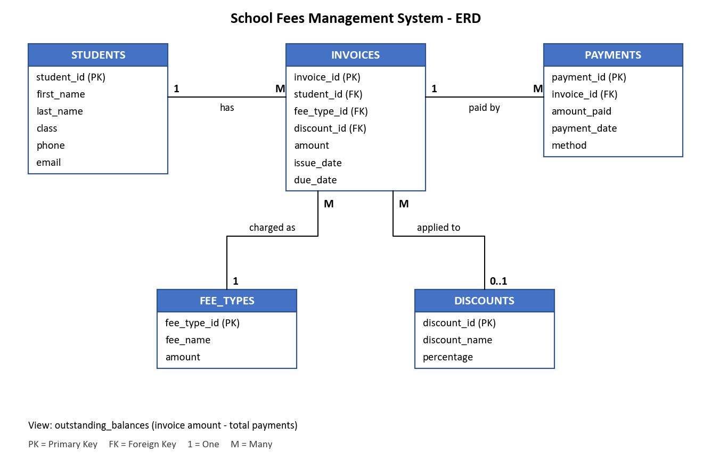

# School Fees Management Database

Weekly deliverable (B3). A simple PostgreSQL database for managing students, fee types, invoices, payments, discounts and outstanding balances.

## Files

- `database_schema.sql` - creates the tables and the `outstanding_balances` view
- `sample_payment_records.sql` - sample data (4 students, 3 fee types, 2 discounts, 6 invoices, 5 payments)
- `queries.sql` - the 8 report queries
- `query_results.md` - output of each query on the sample data
- `ERD.png` - ERD diagram
- `AI_Data_Quality_Note.md` - data-quality checks and how AI was used

## ERD



## Tables

- **students** – student details
- **fee_types** – the kinds of fees and their amount (Tuition, Exam Fee, Transport)
- **discounts** – discount name and percentage (Sibling, Scholarship)
- **invoices** – a fee charged to a student, with an optional discount and a due date. `amount` is the amount after discount
- **payments** – money paid against an invoice. An invoice can be paid in parts

**Relationships**

- One student has many invoices
- One fee type appears on many invoices
- One discount can be used on many invoices (an invoice has zero or one discount)
- One invoice has many payments

**View:** `outstanding_balances` shows each invoice's amount, how much has been paid and the balance left.

## Queries

1. Unpaid fees
2. Payment history
3. Payment history for one student
4. Total collections
5. Total collections by payment method
6. Overdue payments
7. Outstanding balance per student
8. Invoices with discounts

## How to run

Using psql:

```bash
createdb -U postgres school_fees
psql -U postgres -d school_fees -f database_schema.sql
psql -U postgres -d school_fees -f sample_payment_records.sql
psql -U postgres -d school_fees -f queries.sql
```

Or in pgAdmin: create a database called `school_fees`, open the Query Tool, then run `database_schema.sql`, `sample_payment_records.sql` and `queries.sql` in that order.
