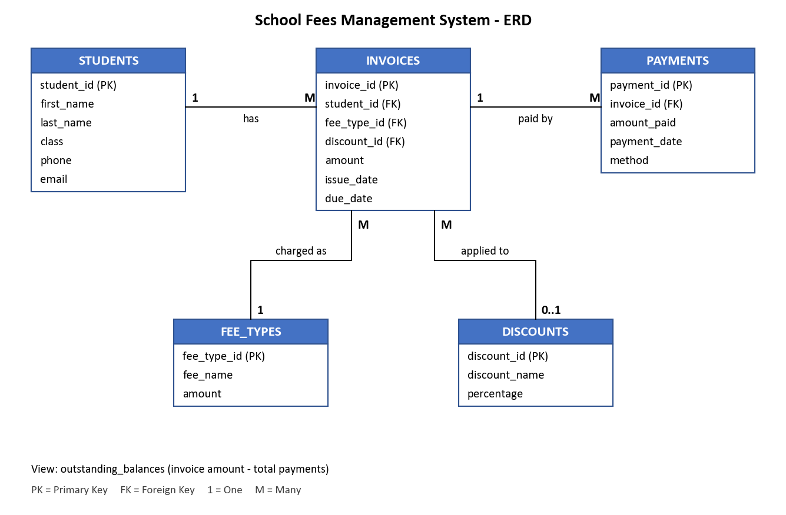

# School Fees Management Database

Weekly deliverable (B3). A simple database for managing students, fee types, invoices, payments, discounts and outstanding balances.

Built with **PostgreSQL**.

## Files

| File | What it is |
|------|------------|
| `schema.sql` | Creates the tables and the `outstanding_balances` view |
| `seed.sql` | Sample data (6 students, 4 fee types, 3 discounts, 11 invoices, 9 payments) |
| `queries.sql` | Report queries |
| `erd.png` | ERD diagram |

## ERD



## Tables

- **students** – student details
- **fee_types** – the kinds of fees and their standard amount (Tuition, Exam Fee, Uniform, Transport)
- **discounts** – discount name and percentage (Sibling, Scholarship, Staff Child)
- **invoices** – a fee charged to a student, with an optional discount and a due date. `amount` is the amount after discount
- **payments** – money paid against an invoice. An invoice can be paid in parts

**Relationships**

- One student has many invoices
- One fee type appears on many invoices
- One discount can be used on many invoices (an invoice has zero or one discount)
- One invoice has many payments

**View:** `outstanding_balances` shows each invoice's amount, how much has been paid and the balance left.

## Queries (in `queries.sql`)

1. **Unpaid fees** – invoices with a balance greater than 0
2. **Payment history** – all payments by date
3. **Payment history for one student**
4. **Total collections**
5. **Total collections by payment method**
6. **Overdue payments** – unpaid invoices past their due date
7. **Outstanding balance per student**
8. **Invoices with discounts**

## How to run

Using psql:

```bash
createdb -U postgres school_fees
psql -U postgres -d school_fees -f schema.sql
psql -U postgres -d school_fees -f seed.sql
psql -U postgres -d school_fees -f queries.sql
```

Or in pgAdmin: create a database called `school_fees`, open the Query Tool, then run `schema.sql`, `seed.sql` and `queries.sql` in that order.

> Note: the overdue query uses `CURRENT_DATE`, so the results depend on the day you run it.
