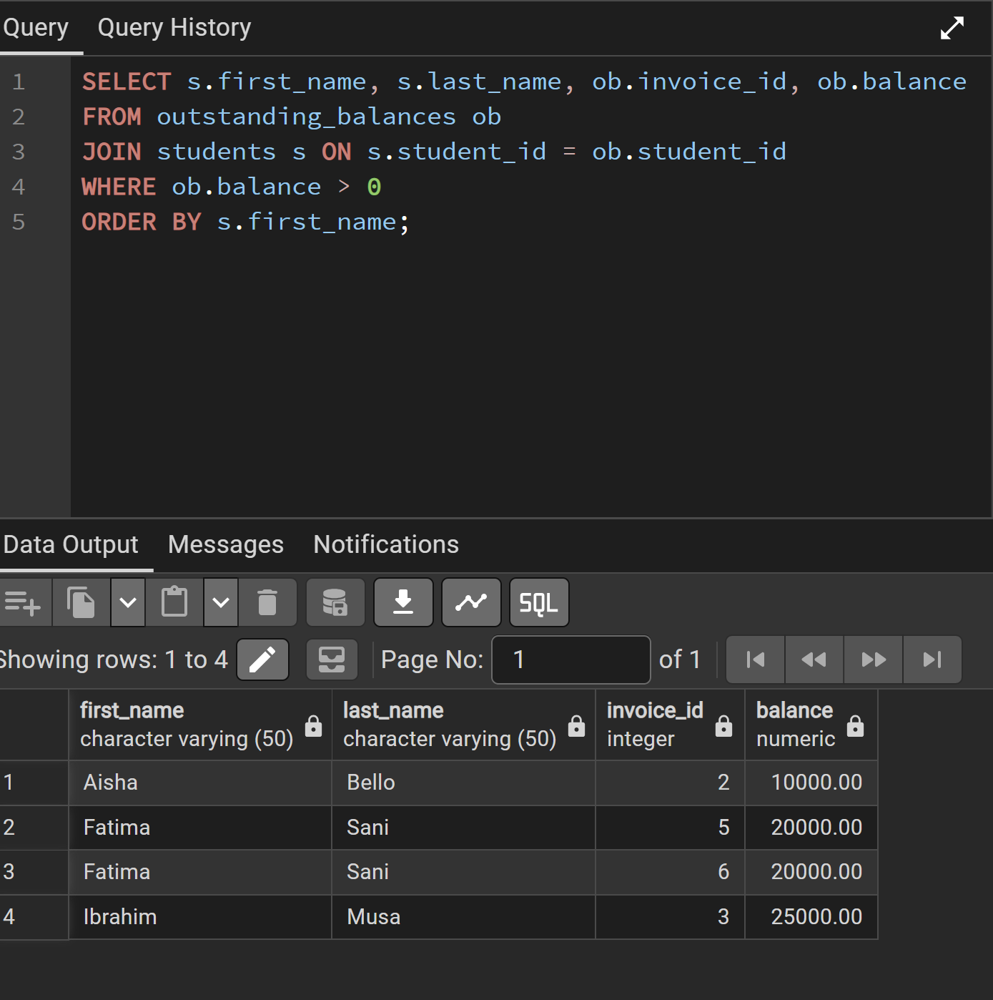
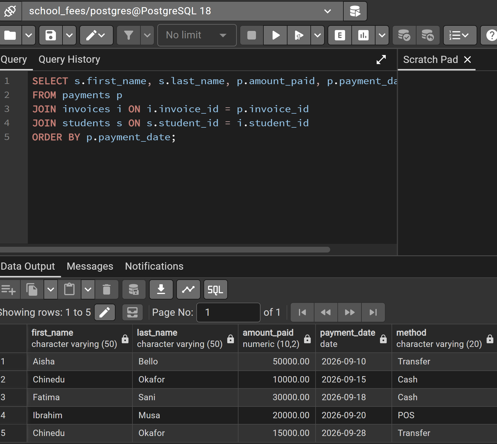
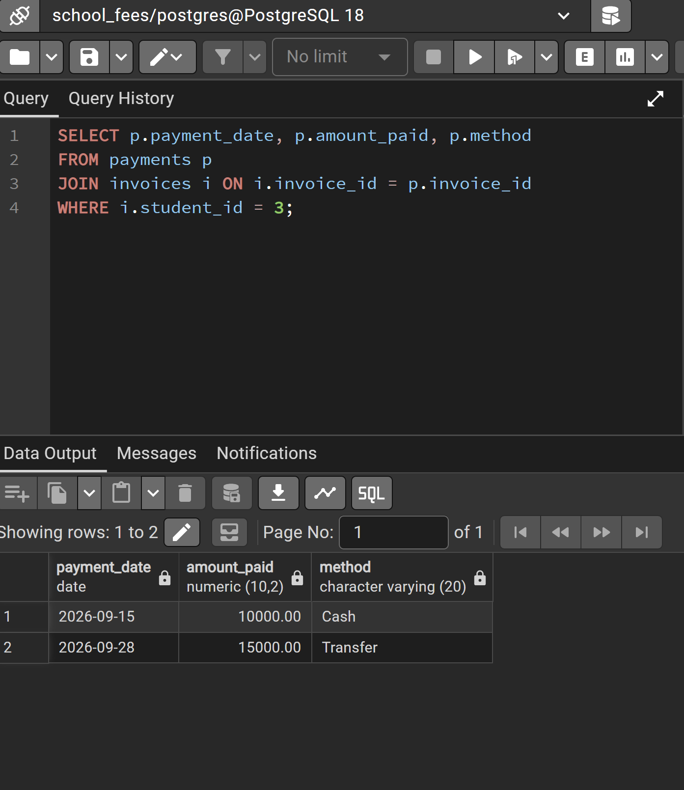
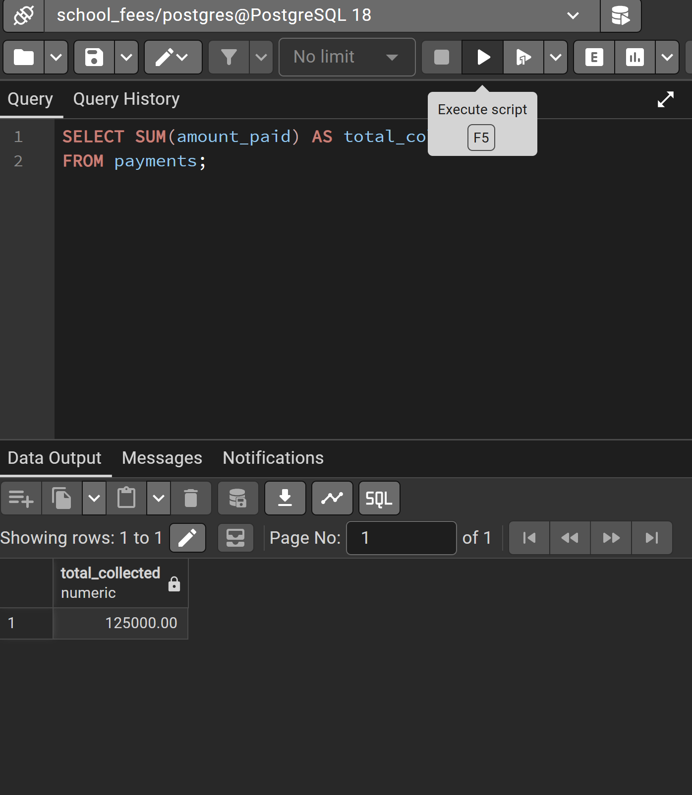
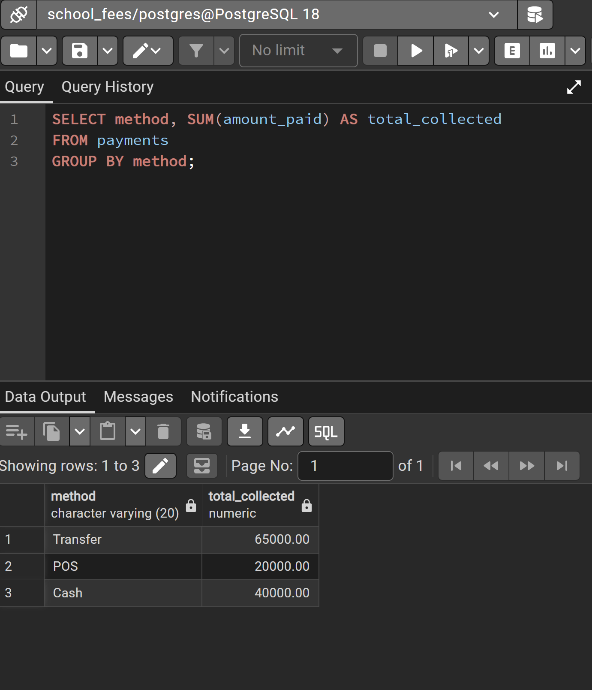
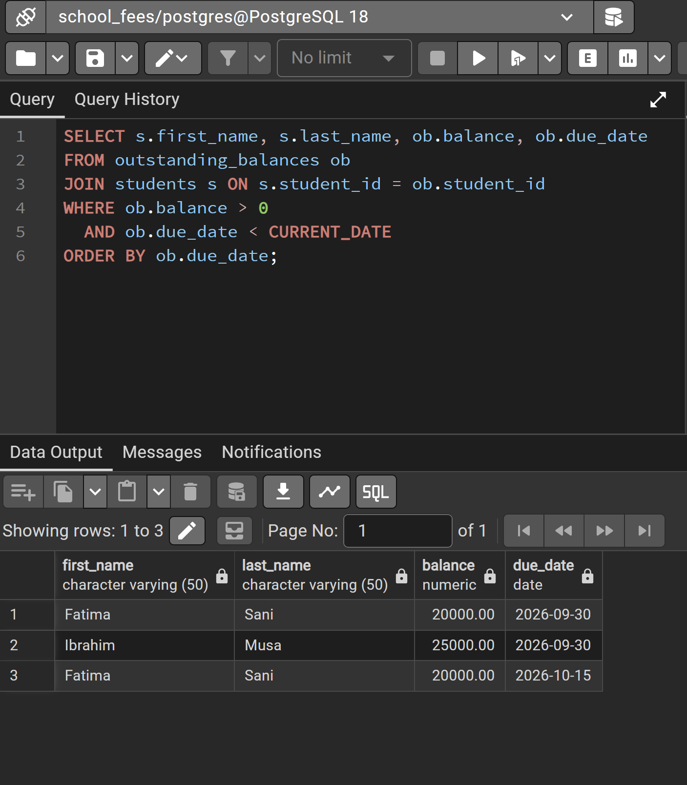
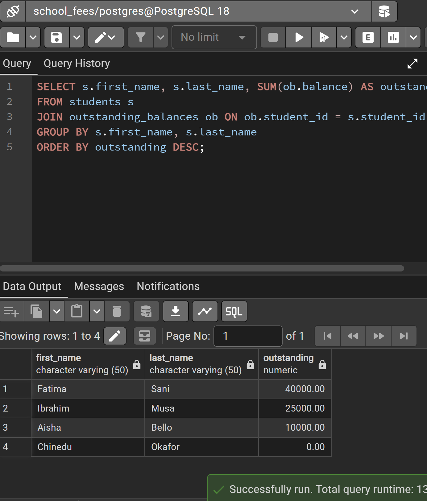
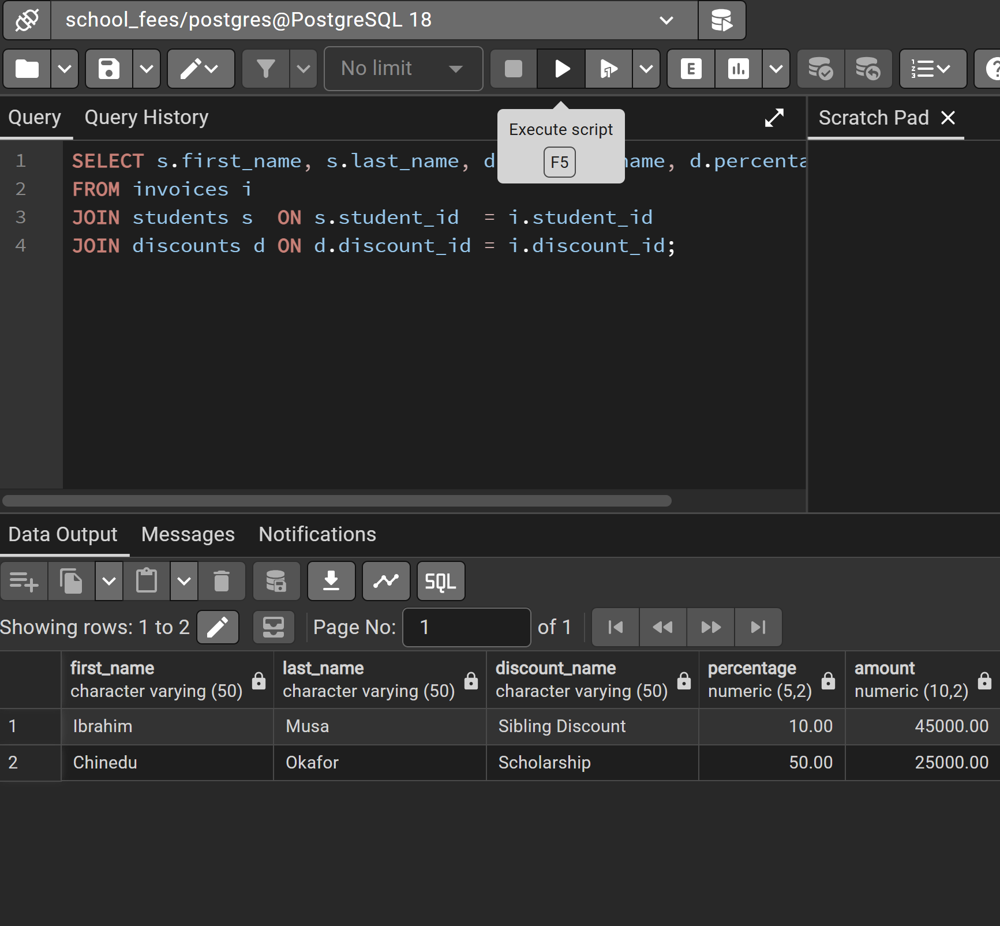

# Query Results

Results from running `queries.sql` on the sample data in PostgreSQL 18.
The overdue query (6) was run on 21 October 2026.
Each query is followed by its psql output and a pgAdmin screenshot.

## 1. Unpaid fees

```sql
SELECT s.first_name, s.last_name, ob.invoice_id, ob.balance
FROM outstanding_balances ob
JOIN students s ON s.student_id = ob.student_id
WHERE ob.balance > 0
ORDER BY s.first_name;
```

```
 first_name | last_name | invoice_id | balance  
------------+-----------+------------+----------
 Aisha      | Bello     |          2 | 10000.00
 Fatima     | Sani      |          5 | 20000.00
 Fatima     | Sani      |          6 | 20000.00
 Ibrahim    | Musa      |          3 | 25000.00
(4 rows)
```



## 2. Payment history

```sql
SELECT s.first_name, s.last_name, p.amount_paid, p.payment_date, p.method
FROM payments p
JOIN invoices i ON i.invoice_id = p.invoice_id
JOIN students s ON s.student_id = i.student_id
ORDER BY p.payment_date;
```

```
 first_name | last_name | amount_paid | payment_date |  method  
------------+-----------+-------------+--------------+----------
 Aisha      | Bello     |    50000.00 | 2026-09-10   | Transfer
 Chinedu    | Okafor    |    10000.00 | 2026-09-15   | Cash
 Fatima     | Sani      |    30000.00 | 2026-09-18   | Cash
 Ibrahim    | Musa      |    20000.00 | 2026-09-20   | POS
 Chinedu    | Okafor    |    15000.00 | 2026-09-28   | Transfer
(5 rows)
```



## 3. Payment history for one student

```sql
SELECT p.payment_date, p.amount_paid, p.method
FROM payments p
JOIN invoices i ON i.invoice_id = p.invoice_id
WHERE i.student_id = 3;
```

```
 payment_date | amount_paid |  method  
--------------+-------------+----------
 2026-09-15   |    10000.00 | Cash
 2026-09-28   |    15000.00 | Transfer
(2 rows)
```



## 4. Total collections

```sql
SELECT SUM(amount_paid) AS total_collected
FROM payments;
```

```
 total_collected 
-----------------
       125000.00
(1 row)
```



## 5. Total collections by payment method

```sql
SELECT method, SUM(amount_paid) AS total_collected
FROM payments
GROUP BY method;
```

```
  method  | total_collected 
----------+-----------------
 Transfer |        65000.00
 POS      |        20000.00
 Cash     |        40000.00
(3 rows)
```



## 6. Overdue payments

```sql
SELECT s.first_name, s.last_name, ob.balance, ob.due_date
FROM outstanding_balances ob
JOIN students s ON s.student_id = ob.student_id
WHERE ob.balance > 0
  AND ob.due_date < CURRENT_DATE
ORDER BY ob.due_date;
```

```
 first_name | last_name | balance  |  due_date  
------------+-----------+----------+------------
 Fatima     | Sani      | 20000.00 | 2026-09-30
 Ibrahim    | Musa      | 25000.00 | 2026-09-30
 Fatima     | Sani      | 20000.00 | 2026-10-15
(3 rows)
```



## 7. Outstanding balance per student

```sql
SELECT s.first_name, s.last_name, SUM(ob.balance) AS outstanding
FROM students s
JOIN outstanding_balances ob ON ob.student_id = s.student_id
GROUP BY s.first_name, s.last_name
ORDER BY outstanding DESC;
```

```
 first_name | last_name | outstanding 
------------+-----------+-------------
 Fatima     | Sani      |    40000.00
 Ibrahim    | Musa      |    25000.00
 Aisha      | Bello     |    10000.00
 Chinedu    | Okafor    |        0.00
(4 rows)
```



## 8. Invoices with discounts

```sql
SELECT s.first_name, s.last_name, d.discount_name, d.percentage, i.amount
FROM invoices i
JOIN students s  ON s.student_id  = i.student_id
JOIN discounts d ON d.discount_id = i.discount_id;
```

```
 first_name | last_name |  discount_name   | percentage |  amount  
------------+-----------+------------------+------------+----------
 Ibrahim    | Musa      | Sibling Discount |      10.00 | 45000.00
 Chinedu    | Okafor    | Scholarship      |      50.00 | 25000.00
(2 rows)
```


